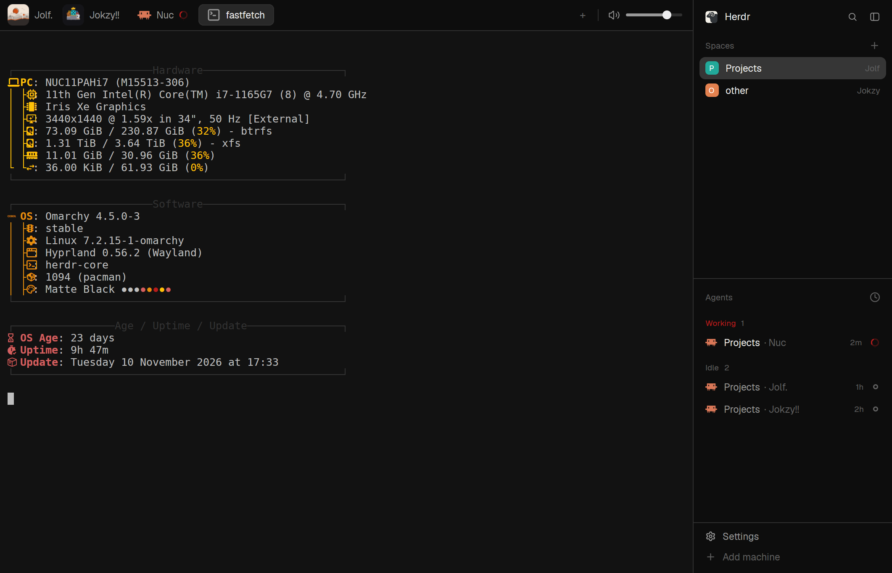

# herdr-minimal

A quiet, near-black layout for the [Herdr](https://herdr.dev) desktop app:

- icon tabs across the top, with your own pictures if you like;
- an alert-volume slider at the bar's right end;
- the sidebar on the right, closing all the way;
- a tmux-style Ctrl+Space prefix, as in Omarchy;
- a sessions popup that lists every open session with what its agent is doing.

## Install

Ask your coding agent, inside Herdr, to *add the layout herdr.dev/layouts/Jok8675/herdr-minimal*. Or do it by hand:

1. Copy `layouts/herdr-minimal.json`, `layouts/herdr-minimal.png`, `themes/herdr-minimal.json` and every folder in `mods/` into `~/.config/herdr-app/`, keeping the folders. Don't overwrite anything you already have; rename on a clash (see RECIPE.md, Watch out).
2. Merge `keys.json` into your own `~/.config/herdr-app/keys.json`. Check the bindings it changes first.
3. Run `herdr-app check ~/.config/herdr-app/mods/<name>` for each mod, then `herdr-app do layout.switch --name herdr-minimal`. Ctrl+Shift+L switches back.

Your own tab pictures: put a square PNG in `mods/tabs-icons/` and add a line to `TAB_ICONS` at the top of `mods/tabs-icons/main.js` with the tab's id from `herdr-app ls`.

## Keys

| | |
|---|---|
| Ctrl+Space | the prefix; then `c` new tab, `r` rename, `k` close tab, `1`–`9` tab, `p`/`n` prev/next, `h`/`v` split, `x` close pane, `z` zoom, **`l` sessions**, **`s` sidebar**, `C`/`R`/`K` new/rename/close space, `P`/`N` prev/next space, `?` help, `d` detach |
| Alt+1–9, Alt+←/→ | tabs |
| Alt+↑/↓ | spaces |
| Alt+Shift+↑/↓ | agents |
| Alt+Shift+←/→ | move the tab |
| Alt+Enter, Alt+Shift+Enter | split down / right |
| Alt+Esc | close pane |
| Ctrl+Alt+arrows | move between panes |

## What it runs

The volume slider is the only part that runs programs. Herdr has no volume setting for its alert sounds, so when you let go of the slider:

- it runs `ffmpeg` (plus `mkdir` and `find`) to write a quieter copy of your alert sound into `~/.config/herdr-app/sounds/volume/`;
- it rewrites `sounds` in `~/.config/herdr-app/settings.json` to point at that copy.

Nothing reaches the network, and it writes only inside Herdr's own folder.

It needs ffmpeg, and an alert sound picked as a file in Settings > Alerts; Herdr's built-in sounds can't be scaled.

## Credits

`tabs-icons` and `workspace-chrome-jok` started as clones of Herdr's own `tabs` and `workspace-chrome` mods (Herdr is Apache-2.0). The theme is Omarchy's Matte Black colours. RECIPE.md is the full build brief.
