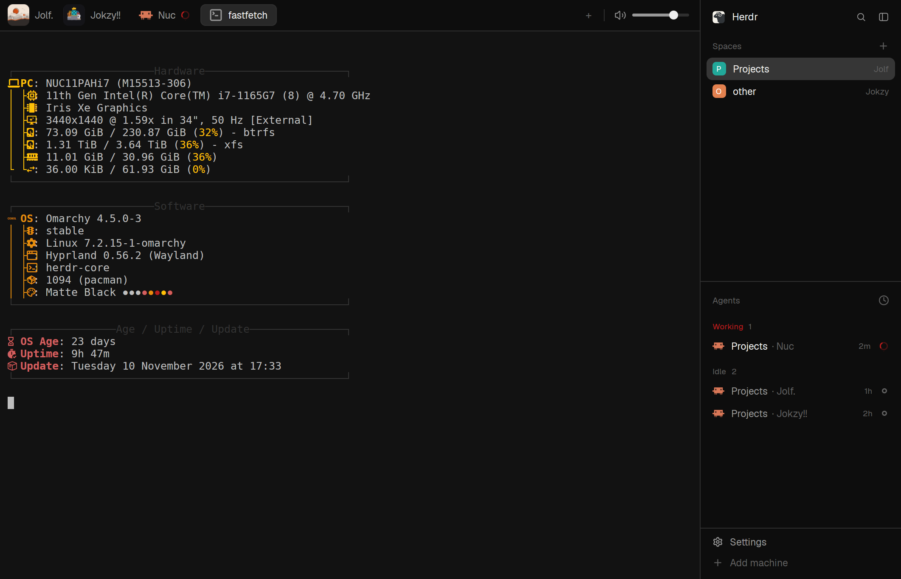

# herdr-minimal

A quiet, near-black Herdr window. A slim tab bar runs across the top: each tab is a pill with a big program icon, or your own square picture, and a red ring while its agent works. An alert-volume slider sits at the bar's right end. The sidebar is on the right (spaces over agents) and closes all the way, leaving nothing behind. Ctrl+Space is a tmux-style prefix, as in Omarchy's Herdr config. Prefix then `l` lists every open session in a popup, and prefix then `s` opens or closes the sidebar. Built and used on Omarchy (Hyprland), Herdr app 0.1.15.

## What you see

Left to right, top to bottom:

- **Tab bar** (top, 42 px, theme `chrome` #0d0d0d, 1 px `border` line under it, drags the window):
  - Tabs as pills, 29 px tall, 7 px corners, 12.8 px text. The shown tab is `raised` #282828 with a 1 px `border` #2f2f2f. The others are flat `chrome` in `muted` #989898 text.
  - Each pill shows its program's icon at 19 px: Claude Code, a shell, and so on. A tab you list in `TAB_ICONS` (in `mods/tabs-icons/main.js`) wears your own square PNG instead, 29 px, as the pill's whole left end. Three example tiles ship (Jokzy, Jolf, an Intel NUC); the map is empty until you add your tab ids.
  - A working agent's tab shows a 12 px ring spinner in `working` #b91c1c. A tab whose agent needs you, or finished, shows a 6 px dot (`blocked` #D35F5F, `done` #e68e0d). No close ×.
  - Right end, in order:
    - `+`: the shipped new-menu.
    - Files and Changes toggles, only if your welcome setup turned those panels on.
    - A sidebar button, only while the sidebar is closed.
    - A 1 × 16 px divider.
    - **The alert volume:** a speaker icon (16 px, three states: off ×, low, high) and a 76 px slider. The groove is 4 px in `border`, the fill is `muted`, the thumb is a 12 px `foreground` dot. All of it turns dim while alerts are off.
- **Terminals** (the main area): the shown tab's panes, with no frame, no border and no corner rounding, on the terminal background #121212, 6 px between split panes. Terminal padding is 10 × 12.
- **Sidebar** (right, 268 px, `chrome`), top to bottom:
  - A 46 px header: the Herdr logo (20 px, 5 px corners), **Herdr** in semibold 13.5 px, then a search button (opens the shipped picker) and a close-sidebar button.
  - The shipped `spaces` list and the shipped `agents` list, sharing the height evenly, each at least 90 px.
  - A 69 px footer: **Settings**, with an accent dot when an app update is ready, and **Add machine** in dim text.
- Hidden until opened: a Files / Changes panel (368 px, between the terminals and the sidebar) and the shipped status bar.
- **Prefix popup** (Ctrl+Space; 680 px wide, 40 px below the top, sized to its content): an accent **PREFIX** chip, "Ctrl+Space, then a key", "Esc" at the right. Below that, the bindings in two wrapped lines of keycaps (`raised`, semibold) and labels (`muted`).
- **Sessions popup** (prefix then `l`; 680 px wide, same spot):
  - An accent **SESSIONS** chip with "3 open · 2 working · 1 needs you".
  - Then each space: a 9 px square in the space's colour, its name, a hairline, and "N tabs · M working".
  - Under each space, its tabs as 48 px rows, each with:
    - a number keycap (1–9);
    - the 30 px icon or picture;
    - the tab name (13 px semibold) with an accent-outlined **here** on the tab you're in;
    - under the name, what the agent is on (its terminal title, `muted`) and its folder and branch (`dim`);
    - the status at the right: ring + "working 11m", dot + "needs you", dot + "done", ring + "idle 7m", or "shell".
  - The keyboard selection is `selected` #363636.
  - The footer has keycap hints: ↑↓ move, ⏎ go, 1-9 jump, Esc close.

The theme (`themes/herdr-minimal.json`) is Omarchy's Matte Black: #121212 background, #bebebe text, amber accent #e68e0d.

## How it behaves

- **Agent status:**
  - **working:** a red ring spinning once every 900 ms, on the tab, in the agents list and in the sessions popup.
  - **blocked:** a red dot, "needs you".
  - **done:** an amber dot.
  - **idle:** nothing on the tab, a hollow ring in the popup.
- **Tabs:**
  - Click to show.
  - Press on one and release on another to move it there.
  - Double-click to rename. Right-click for the shipped tab menu.
  - The mouse wheel over the bar steps through tabs.
  - The shown tab scrolls into view when the bar is too narrow.
- **Alert volume:** Herdr has no volume setting for its alert sounds; `settings.json` names a file for `done` and `blocked`. When you let go of the slider:
  - ffmpeg writes a copy of that sound at the new level into `sounds/volume/` and points `settings.json` there. At 100% it points back at the original.
  - It plays once at the new level, and older copies are deleted.
  - The curve is the desktop's, cubic: 50% is −18 dB.
  - The wheel over the slider steps 5% (saved 0.4 s after the last notch) instead of switching tabs.
  - Clicking the speaker mutes or unmutes with `sounds.enabled`; unmuting returns to the last level. 0% also turns alerts off.
  - A new sound picked in Settings > Alerts becomes the new original.
- **Sidebar:**
  - Its own button hides it completely, with no 44 px rail. It remembers its width, and a sidebar left on the old rail reopens full width.
  - The tab bar's sidebar button, prefix then `s`, or Ctrl+Shift+B bring it back.
- **Prefix:** Ctrl+Space opens the popup. The next key runs its binding and closes it; any other key, Esc, or Ctrl+Space again just closes it.

  | key | does | key | does |
  |---|---|---|---|
  | `c` | new tab | `h` / `v` | split down / right |
  | `r` | rename tab | `x` | close pane |
  | `k` | close tab | `z` | zoom pane |
  | `1`–`9` | go to tab | `l` | sessions popup |
  | `p` / `n` | previous / next tab | `s` | sidebar open / close |
  | `C` `R` `K` | new / rename / close space | `?` | help |
  | `P` / `N` | previous / next space | `d` | detach (closes the window; terminals keep running) |

- **Sessions popup:**
  - It opens on the tab you're in.
  - ↑/↓, j/k, Ctrl+P/N and Tab move the selection. Enter, `l` or → go there. `1`–`9` go straight to that tab. Esc or `q` closes it.
  - A click goes to the tab. Times refresh every 20 s while it's open.
- **Keys (`keys.json`):**
  - Alt+1–9 or Ctrl+1–9: tab 1–9.
  - Alt+←/→, Alt+[/]: previous / next tab. Alt+↑/↓: previous / next space.
  - Alt+Shift+↑/↓: previous / next agent. Alt+Shift+←/→: move the shown tab one place left / right.
  - Alt+Enter / Alt+Shift+Enter: split down / right. Alt+Esc: close the pane.
  - Ctrl+Alt+arrows: move between panes.

## Built from

- **Layout `layouts/herdr-minimal.json`** (a clone of Herdr's `main` 0.1.15). The root is a `row` (background `canvas`, 1 px `border` divider, `titlebar: "none"`, theme `herdr-minimal`, terminal padding [10, 12]) with these children:
  - `work` (column, not resizable):
    - `tabs` block, 42 px, mod `tabs-icons`, `window_drag`.
    - `work-body` row:
      - `main` block: `{ "tab": "active" }` with pane frames: background `background`, border 0, focus 0, radius 0, gap 6, `lone: true`.
      - `panel` column: 368 px, min 280, max 900, hidden. It holds a `panel-body` stack of the shipped `files` and `changes`.
    - `status` block, 28 px, shipped `workspace-status`, hidden.
  - `sidebar` (column, 268 px, min 44, max 480, background `chrome`, not resizable):
    - `brand` block, 46 px, mod `workspace-chrome-jok`, `window_drag`.
    - `sidebar-lists` column with the shipped `spaces` and `agents`, each weight 1, min 90.
    - `sidebar-footer` block, 69 px, mod `workspace-chrome-jok`, props `{ "footer": true }`.
- **`mods/tabs-icons`:** a clone of Herdr's `tabs`. It holds:
  - The pills and drag-to-move, plus the per-space Files/Changes panel memory (localStorage), from the clone.
  - `TAB_ICONS` (tab id → PNG), published as shared `"tab-icons"` for the sessions popup.
  - The volume control: gpui-base `SliderState` / `Slider` / `SliderTrack` / `SliderIndicator` / `SliderThumb`.
  - It reads and writes `settings.json` with `readTextFile` / `writeTextFile` (with the text it read as `expected`, retried on a stale write). It runs `ffmpeg`, `mkdir` and `find` through `exec`, and calls `playSound`. It keeps `{level, last, src}` in shared `"alert-volume"`.
  - Assets: `volume-1/2/x.svg`, the Windows window-button SVGs, and the three example tiles.
- **`mods/workspace-chrome-jok`:** a clone of Herdr's `workspace-chrome`. It draws the sidebar header and footer. Its close button runs `layout.hide sidebar`, with no rail; the width goes in shared `"sidebar.width"`. Footer: `app.settings`, `mod.open machine-add`. It uses the clone's own SVGs and Herdr's `frame/welcome/herdr.png`.
- **`mods/omarchy-prefix`:** a popup (`at: "top"`, offset 40, 680 wide, height ≤ 120). It takes focus in `init` (again 30 ms later) and maps the next key through a `KEYS` table to `run(...)`.
- **`mods/sessions`:** a popup (`at: "top"`, offset 40, 680 wide, height ≤ 600). It reads `spaces()`, `panes()`, `home()`, shared `"tab-icons"` and `"space.colors"`. It goes to a tab with `space.select` + `tab.select` and scrolls with `ScrollHandle.scroll_to_item`.
- **`mods/omarchy-tab-left`, `mods/omarchy-tab-right`:** invisible popups (frame `none`) that run `tab.move` one place either way and close at once.
- **Shipped mods it relies on:** `spaces`, `agents`, `files`, `changes`, `workspace-status`, `new-menu`, `menu`, `picker`, `machine-add`. It also uses `mods/workspace-chrome/spinner.svg`, `mods/files/file.svg`, `mods/changes/changes.svg` and `mods/pane/close.svg`.
- **`keys.json`:** only the bindings this setup adds or changes.

## Watch out

- **Popups size to their content, up to the `height` in `mod.json`; windows (`kind: "window"`) are exactly that height.** At 620 px the prefix hints wrapped to a third line and the 92 px popup cut it off. At 680 they fit on two lines, and the cap is 120 so a narrow window can still show three.
- **A list that should fill a popup can't use `flex_1()`.** With nothing to fill, it collapses to 0 px. Give it a `max_h` and let the popup size to it.
- **On this theme `input` is the same colour as `chrome`.** A slider groove in `input` vanishes on the bar, and the slider looks full when it isn't. Use `border`.
- **The slider needs all four parts** (no `SliderIndicator` and it can't be moved). A 12 px thumb sits centred on a 4 px groove with `.ml(-6).mt(-4)`.
- **Stop the wheel's propagation over the slider,** or the bar's own wheel handler switches tabs.
- **Volume:**
  - It needs `ffmpeg` (with libmp3lame) on PATH.
  - Herdr's built-in sounds live inside the app and can't be scaled: pick a file in Settings > Alerts first. The slider says so in a toast.
  - It writes only under `~/.config/herdr-app` (`settings.json` and `sounds/volume/`). It never touches the network.
- **`TAB_ICONS` is keyed by tab id** (`herdr-app ls`, ids start `tb`), so a rename keeps the picture. A tab wearing one has no border and no left padding: the tab clips its children inside its border, and a negative margin breaks the bar's layout.
- **This `keys.json` changes some defaults.** Alt+1–9 pick tabs, not spaces. Alt+←/→ go between tabs, not panes (panes are Ctrl+Alt+arrows). Alt+↑/↓ go between spaces, not agents (agents are Alt+Shift+↑/↓). Merging it doesn't remove the default Alt+H/J/K/L pane moves.
- **Ctrl+Space no longer reaches terminal programs** while the prefix is bound to it.
- **Mod names are kept from the original build** (`tabs-icons`, `workspace-chrome-jok`, `omarchy-*`). If yours clash, rename the folder, the `mod` names in the layout, `keys.json`, and the `mods/<name>/` asset paths inside the code.

## Done when

- `herdr-app check` passes for all six mods. `herdr-app do layout.switch --name herdr-minimal` shows:
  - the tab bar on top;
  - the sidebar on the right, with the Herdr header, spaces, agents, Settings and Add machine;
  - the volume slider as the last thing on the bar.
- A tab whose agent is working shows a spinning ring on its pill.
- Releasing the slider at 50% writes `sounds/volume/done-<sound>-50.mp3`, `settings.json` names it under `sounds.done`, and it plays once. Clicking the speaker sets `sounds.enabled` to false, and clicking again brings the 50% back.
- The sidebar's own button hides it fully. The tab bar then shows a sidebar button, which brings it back. Prefix then `s` toggles it.
- Ctrl+Space shows the prefix popup with its hints on two lines, and `c` opens a new tab.
- Prefix then `l` lists every tab under its space with the right status. Enter on another row switches to that tab, and `2` jumps to the second.
- Alt+Shift+→ moves the shown tab one place right.
